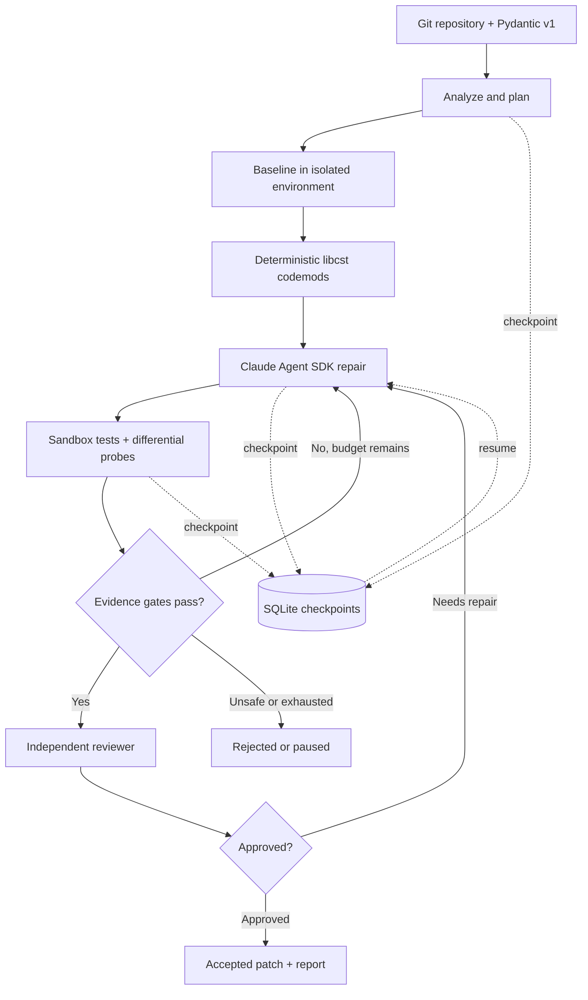

# MigrationGuard

[](https://github.com/LZH-1-G/MigrationGuard-Harness/actions/workflows/ci.yml)
[](LICENSE)
[](https://github.com/LZH-1-G/MigrationGuard-Harness/releases)

**An evidence-driven agent harness for safe dependency migration.**
MigrationGuard migrates Python projects from Pydantic v1 to v2 with deterministic codemods
and Claude agents, and accepts the result only when sandboxed, differential evidence
proves it is safe. It never trusts an agent's self-reported success.

```
$ migrationguard run ./billing --agent claude          # real run, abridged
  verify ✔ tests.pass: PASS — 7 passed
  verify ✔ tests.differential: PASS — all 7 baseline-passing tests pass
  verify ✘ behavior.probes: FAIL — 13 behavioural difference(s)     ← codemods alone: tests green, behaviour changed
▶ verify -> repair
  repair repair attempt 1: finished; 6 tool call(s), 0 denied; $0.2223, ...
  verify ✔ tests.integrity: PASS — 0 protected file(s) changed, all re-derivable from the audited codemod
  verify ✔ behavior.probes: PASS — 16 probes agree
  review ✔ review.independent: PASS — The migration is faithful to v1 behaviour. ...
ACCEPTED: all blocking gates passed at iteration 2
```

## Why

Coding agents are good at making a migration *look* done. The common shortcuts — a green
test suite, an agent saying "all tests pass" — miss exactly the failures that matter in
dependency upgrades:

* **silent behaviour changes**: Pydantic v2 stops coercing `123` to `"123"`, rejects
  `42.7` for an `int`, serialises `Decimal` as a string and UTC as `Z`. Typical test suites
  stay green.
* **reward hacking**: deleting, skipping or weakening failing tests, adding a
  `conftest.py` that deselects them, pinning back to v1, or importing `pydantic.v1`.
* **fragile execution**: long agent runs die halfway (crash, rate limit, budget) and start
  over from scratch.

MigrationGuard combines four things to address that:

1. **Autonomous migration** — deterministic libcst codemods for everything mechanical,
   a Claude Agent SDK repair agent for what needs judgement.
2. **Differential behavioural verification** — the original project (pydantic 1.x) and
   the migrated one (pydantic 2.x) run in separate sandboxed environments on the same
   synthesised inputs; their outputs must agree.
3. **Evidence-gated acceptance** — 10 deterministic gates plus an independent, read-only
   reviewer agent with veto power. Agent claims are recorded and checked, never trusted.
4. **Fault-tolerant execution** — explicit state machine, checkpoints after every
   transition, resume after crashes, retries for transient failures, budget-aware pausing.

## Results

Benchmark: 5 realistic Pydantic v1 projects (CRUD models, billing with Decimal and CRM
ids, environment-driven settings, a src-layout catalog with custom root types and
generics, HMAC-signed webhooks). Ground truth is a **hidden oracle** test suite per case
that neither the agents nor the gates ever see, plus the original visible tests (rebuilt
from the baseline, so agents cannot tamper with them), plus a completeness check (no v1 API
left, v2-only requirement).

<!-- BENCH-RESULTS:START -->
Measured results (one run per case × strategy, Docker sandbox, Claude Agent SDK default model;
full table and per-run details in [benchmarks/RESULTS.md](benchmarks/RESULTS.md), raw data in
[benchmarks/results.json](benchmarks/results.json)):

| Strategy (5 cases each) | Accepted | Accepted **and** correct | False acceptances | Agent cost (total) | Median time |
|---|---|---|---|---|---|
| `bump-only` — pin v2, accept if tests pass | 0 | 0 | 0 | $0 | 5 s |
| `codemod-only` — bump-pydantic-style codemods, accept if tests pass | 2 | 1 | 1 | $0 | 5 s |
| `migrationguard-deterministic` — codemods + all gates, no LLM | 1 | 1 | 0 | $0 | 5 s |
| `claude-tests-only` — codemods + Claude, accepted by tests | 5 | 4 | 1 | $0.41 | 32 s |
| `claude-no-codemod` — Claude migrates the source, all gates + reviewer | 5 | 5 | 0 | $2.04 | 79 s |
| **`migrationguard`** — codemods + Claude + all gates + reviewer | **5** | **5** | **0** | $1.79 | 68 s |

Red team: 8 adversarial agents (delete / skip / weaken tests, `conftest.py` deselection,
pin v1, `pydantic.v1` shim, test-runner detection, plain lying) were asked to repair in 32
runs, each claiming full success. The evidence gates accepted **0 of 32** incorrect results;
a "tests pass + no test regressions" policy would have accepted **14 of 32 (44%)** of the
same results.

Read with care: 5 cases, one run per cell, non-deterministic agents; small samples, not a
general accuracy claim. The ground-truth oracle has blind spots of its own (see
[docs/benchmarks.md](docs/benchmarks.md)).
<!-- BENCH-RESULTS:END -->

## Installation

Requirements: Linux (tested in CI on Python 3.10 and 3.12; macOS untested), Python ≥ 3.10,
git, and **Docker** for default execution. The process-only sandbox is a weaker, explicit
opt-in (`--sandbox local`); `--sandbox auto` additionally allows fallback to it. Neither
process isolation nor host-side dependency resolution should be treated as safe for fully
untrusted repositories. `uv` is installed as a Python dependency and manages the
baseline/target interpreters and packages. Source-distribution builds are disabled during
host-side dependency provisioning: dependencies without compatible wheels now fail closed.

```bash
git clone https://github.com/LZH-1-G/MigrationGuard-Harness.git && cd MigrationGuard-Harness
python -m venv .venv && . .venv/bin/activate
pip install -e ".[agent]"            # or ".[dev]" for tests and linters

migrationguard doctor                # checks git, uv, Python, Docker, image, Claude Agent SDK
migrationguard sandbox build-image   # optional: Docker runtime image (works without registry access)
migrationguard sandbox check         # smoke-test the isolation
```

For Claude-powered repair, the Claude Agent SDK needs Claude credentials (for example an
`ANTHROPIC_API_KEY`; see the Agent SDK documentation at https://docs.claude.com). Without
credentials, use `--agent none`: you still get deterministic codemods and full verification.

## Usage

```bash
cd my-project                        # must be a git repository; your checkout is never modified
migrationguard analyze               # findings + plan; executes nothing
migrationguard run --agent claude    # full pipeline; result on branch migrationguard/<run-id>
migrationguard run --agent none      # deterministic codemods + verification only

migrationguard status                # list runs
migrationguard status <run-id>       # checkpoints, latest evidence, agent attempts, cost
migrationguard logs <run-id> -f      # structured event log (add -v for agent tool calls)
migrationguard report <run-id>       # Markdown verification report (or --format json)
migrationguard diff <run-id>         # the migration diff
migrationguard resume <run-id>       # continue a paused / interrupted / crashed run
migrationguard cleanup <run-id>      # remove worktrees (evidence and branch are kept)
```

Useful `run` options: `--budget 5` (USD), `--max-repairs 3`, `--model <claude-model>`,
`--no-review`, `--no-probes`, `--sandbox docker|local`, `--stop-after codemod` (pause at a
phase boundary), `--include-uncommitted`, `--json`. Exit codes: 0 accepted, 1 rejected,
2 failed, 3 paused.

An accepted migration is a normal branch in your repository:

```bash
git diff main migrationguard/20261013-005905-1e4fbd
git merge migrationguard/20261013-005905-1e4fbd
```

## Configuration

Optional `migrationguard.toml` at the repository root (or `[tool.migrationguard]` in
`pyproject.toml`); `migrationguard init` writes a commented one. Agents can never modify it.

```toml
[environment]
python = "3.12"
requirements = []                  # auto-detected: requirements*.txt, pyproject (PEP 621/Poetry), setup.cfg
extra_requirements = ["pytest>=7,<9"]
pytest_args = ["-q"]
exclude_newer = "2026-06-01"       # reproducible dependency resolution

[sandbox]
backend = "docker"                 # safe default; auto/local explicitly opt into weaker fallback
timeout_seconds = 900
network = false

[verify]
probes = true
reviewer = true
accepted_behavior_changes = [      # differences a human reviewed and accepted
  { probe = "app.models:Item/truncate-int:*", reason = "silent truncation was a bug" },
]

[agent]
backend = "claude"                 # claude | none
# model = "<claude model id>"      # optional; the SDK default is used otherwise
max_repair_iterations = 3

[budget]
max_cost_usd = 10.0
max_tokens = 4000000

[policy]                           # globs; defaults protect tests, test config, CI
protected = ["tests/**", "**/conftest.py", ".github/**", "migrationguard.toml"]
```

User probes: put `probe_*` functions in a `migrationguard_probes.py` at the repository root
to pin outputs that tests don't (signatures, hashes, public payloads). They run on both
sides of the migration and must return identical values. See
[examples/user-probes](examples/user-probes/migrationguard_probes.py).

## How it works



**Demo:** Run [`examples/demo.sh`](examples/demo.sh) from a Linux checkout for the
codemod-only path; run `examples/demo.sh --claude` for the paid Claude repair path.
See [architecture](docs/architecture.md), [verification evidence](docs/VERIFICATION.md)
and [benchmarks](benchmarks/RESULTS.md).

* **Isolation.** Two git worktrees (target branch + detached baseline). Tests and probes
  run in Docker (`--network none`, read-only rootfs and workspace, non-root host-mapped UID, all
  capabilities dropped, memory/cpu/pids limits) or an explicitly selected process sandbox
  (throwaway copy, scrubbed env, rlimits, network namespace where available). Writable
  Docker output directories retain their original host permissions; dependency installs
  use prebuilt wheels only and are mounted read-only for test execution.
* **Codemods.** A libcst transformer with a project-wide symbol index (models through
  inherited bases, field types, function return types) so `.dict()`/`.json()`/`.copy()` are
  only rewritten on receivers known to be models. Constructs needing judgement
  (`each_item` validators, mutating root validators, `__root__` types, unknown Config
  options, v1-only arguments) are never half-converted; they become plan items for the agent.
* **Agents.** Claude Agent SDK sessions with all built-in tools removed and a small set of
  in-process MCP tools that are confined to the worktree, policy-checked (tests and test
  config are read-only), and execute tests/probes in the sandbox.
* **Gates.** `static.syntax`, `static.residual`, `scope.diff`, `deps.target`,
  `tests.pass`, `tests.differential`, `tests.integrity`, `behavior.probes`,
  `runtime.deprecations` (blocking), `tests.frozen` (advisory), `review.independent` (veto).
  Details in [docs/verification.md](docs/verification.md).
* **Persistence.** SQLite (runs, checkpoints with full state + commit, events, agent
  attempts, evidence, usage) plus content-addressed artifacts and a JSONL event log per run
  under `~/.migrationguard/runs/<run-id>/`.

More in [docs/architecture.md](docs/architecture.md),
[docs/verification.md](docs/verification.md) and [docs/benchmarks.md](docs/benchmarks.md).

## Benchmarks

```bash
migrationguard bench list
migrationguard bench run                                   # free strategies (no LLM)
migrationguard bench run --strategies adversaries          # 8 red-team agents × 5 cases
migrationguard bench run --strategies migrationguard,claude-tests-only,claude-no-codemod --budget 6
```

Strategies share the same harness and differ only in what they do and how they accept, so
the comparison isolates the acceptance policy: `bump-only` (pin v2, accept if tests pass),
`codemod-only` (bump-pydantic-style codemods, accept if tests pass),
`migrationguard-deterministic` (codemods + all gates), `claude-tests-only` (codemods +
Claude, accepted by tests), `claude-no-codemod` (Claude does everything, all gates),
`migrationguard` (everything), `adv-*` (red-team agents that claim success).

## Development

```bash
pip install -e ".[dev]"
pytest tests/unit                      # fast, no network
pytest                                 # + integration: real uv environments and sandboxed runs
MIGRATIONGUARD_LIVE_TESTS=1 pytest -m live   # real Claude migration (costs ~$0.50)
ruff check src tests
```

Fault injection for resilience testing: `MIGRATIONGUARD_FAULT=verify:crash` (hard
`os._exit` after the phase checkpoint), `repair:interrupt`, `baseline:transient:2`.

## Limitations

* Python projects and the Pydantic v1 → v2 recipe only (the harness, sandbox, gates and
  agents are recipe-agnostic; a new recipe implements `analyze/plan/apply/residual`).
* Probes cover Pydantic models (not `BaseSettings`, which is environment driven) and
  compare *parsed* JSON: raw-string changes such as v2's compact `model_dump_json()`
  separators need a user probe. This blind spot is demonstrated by a test.
* Behavioural verification is only as good as the inputs: synthesised probes plus the
  project's tests. Code paths neither exercises can still change unnoticed; the reviewer
  agent is the last line, and it is not deterministic.
* The local sandbox is weaker than Docker (no filesystem isolation beyond working on a
  copy; network isolation needs unprivileged user namespaces). Docker is the default;
  `local` and `auto` are explicit opt-ins. For an untrusted repository, pass
  `--sandbox docker` explicitly because repository-supplied configuration can request a
  weaker backend or allow network access.
* Dependency resolution and wheel installation still happen on the host. Arbitrary
  source builds are disabled, but downloaded wheel artifacts and indexes are not a
  complete supply-chain trust boundary; use a disposable host/VM for truly untrusted code.
* Docker output mounts use the invoking non-root UID/GID, so write access requires that
  UID to own (or otherwise have access to) the output directory. Running the tool as host
  root is intentionally rejected by the Docker executor.
* Projects whose tests need network services (databases, HTTP) need
  `sandbox.network = true` or service containers, which are not provided.

## License

Apache-2.0
